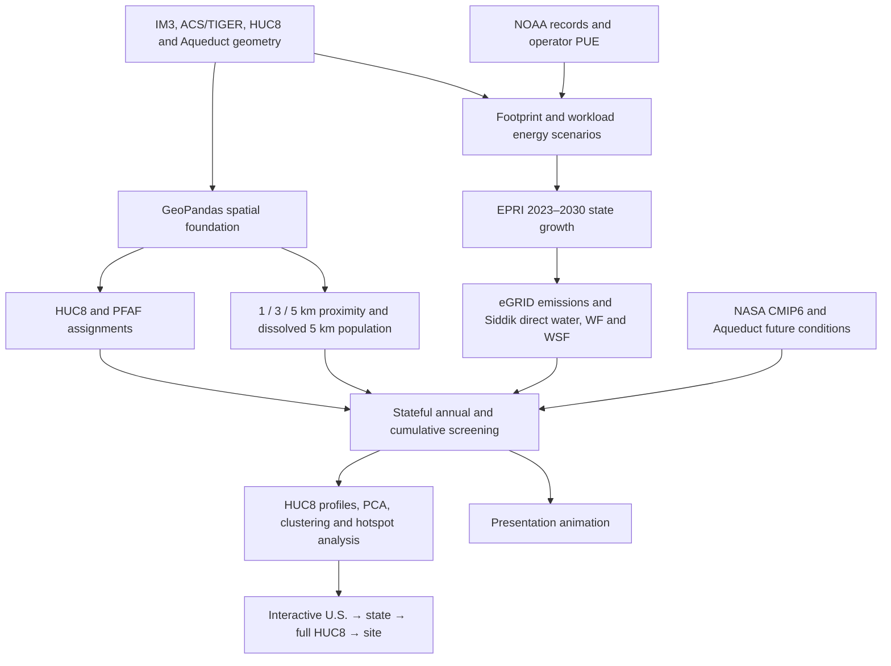

# Data Center Community Impact

## Research Question

How can public site, electricity, water, climate and population data help compare the modeled resource pressures associated with U.S. data centers through 2030?

## Project Overview

This Python research project starts with 1,474 IM3 records: 1,237 buildings, 132 campuses and 105 point locations. Building footprints support scenario-based electricity estimates. The site inventory also provides geographic context for watershed assignments and community proximity.

## Key Contributions

GeoPandas supplies the spatial operations. The project's Python implementation defines the equations, joins, scenario assumptions, state transitions and screening logic.

- Estimate facility electricity using building footprints, calibrated power-density quantiles, AI training/inference workloads and fixed or site-adjusted PUE.
- Propagate state-specific EPRI growth from 2023–2030 and account for annual and cumulative eGRID emissions.
- Model direct water and separate Siddik water footprint (WF) and scarcity-weighted water footprint (WSF) quantities.
- Join Aqueduct 4.0 watershed conditions and NASA CMIP6 climate context with static ACS population proximity.
- Estimate population within 1, 3 and 5 km using area weighting, and dissolve overlapping 5 km buffers for group totals.
- Aggregate stateful outputs by HUC8, compare scenario ranks, and derive PCA, clustering and hotspot classifications.
- Explore U.S. → state → full HUC8 → site in the offline dashboard, with an animation for presentation backup.

## System Architecture



## Geospatial Foundation

The pipeline uses GeoDataFrames, CRS transforms, spatial joins, geometry repair, tract intersections and buffer unions. HUC8 and Aqueduct PFAF identifiers stay separate. [Spatial architecture](docs/architecture.md)

## Implementations Built on GeoPandas

The project defines the facility energy equations, unit conversions, EPRI trajectories, missing-data rules, downstream accounting and watershed screening criteria. It also validates the scientific joins and provides the dashboard's selection logic. [Representative Python implementations](docs/implementation_highlights.md) · [Methodology](docs/methodology.md)

## Data Sources

IM3 supplies facility records, EPA eGRID provides subregions and factors, and EPRI provides state demand endpoints. Siddik supplies HUC8 water factors, ACS/TIGER provides population and tract geometry, and WRI Aqueduct supplies water-risk context. NASA CMIP6 provides projected temperature context. NOAA and published operator PUE support the climate adjustment. The project uses published data-center energy literature, including the LBNL U.S. Data Center Energy Usage Report, for assumptions and context. [Source inventory and local paths](data/README.md) · [Provenance](docs/data_sources.md)

## Installation

Use Python 3.14 for the tested pinned environment, and run commands from the repository root.

```bash
python3 -m venv .venv
source .venv/bin/activate
python3 -m pip install -r requirements.txt
```

On the presentation Mac, the two shell scripts use the existing `~/.venvs/data-center-impact` environment configured in the launchers. Other installations can use the module commands below.

## Quick Start

```bash
python3 -m scripts.smoke_test_dashboard
python3 -m src.dashboard.presentation
```

Open the printed localhost URL. The compact snapshot supports this workflow without raw inputs.

## Run Tests

```bash
python3 -m pytest tests -q
```

### Validation

The full suite passed **170 tests and 41 subtests** in the shared Python environment. The presentation smoke test verifies the compact snapshot, required maps and navigation callbacks.

## Run the Analysis

The saved snapshot supports immediate exploration. To regenerate analyses, obtain the required local inputs first. [Data inventory](data/README.md) · [Detailed workflow](docs/resource_analysis.md)

### Climate-adjusted PUE scenario

Run these commands from the repository root in the project Python environment.
The first command uses NOAA daily temperature records and published operator
PUE to generate a fitted PUE for each site and a report of the fit.

```bash
python -m extra_functions.pue_climate
python -m src.model.apply_im3_energy_model --power-density-scenario low --workload-scenario ai_inference --climate-pue data/processed/site_pue_climate.csv
python -m src.analysis.epri_temporal_emissions --sites data/processed/data_centers_with_energy_climate.csv --output-dir outputs/climate_pue
```

Rebuild the dashboard's simulation and watershed tables after updating the
climate-adjusted energy file, then refresh the compact dashboard snapshot.

```bash
python -m src.analysis.stateful_community_simulation
python -m src.analysis.huc8_environmental_profiles --tables-only
python -m src.dashboard.validate
```

The simulation uses climate-adjusted energy by default. The
`--baseline-pue` flag rebuilds the same dashboard outputs with fixed PUE.
Restart a running dashboard after regenerating the tables.

The low-density AI inference settings match the default temporal emissions
scenario. For a matched baseline, run the energy model with the same settings
and omit `--climate-pue`. Give that run a separate `--output` path and pass it to
the emissions command with a separate `--output-dir`.

The energy estimates record the PUE used and mark each climate run row as
`climate_fitted` or `scenario_fallback`. A site without fitted PUE uses its
workload scenario's PUE. The fitted values use one long-term PUE per site,
anchored at 1.40 for the median site climate.


## Interactive Dashboard

The hierarchy is **United States → state → full HUC8 watershed → site**. State selection filters the list of watersheds by site assignment. Displayed watershed polygons retain their full boundaries across state lines. [Dashboard methods](docs/dashboard.md)

### Live Presentation Dashboard

From the repository root on the presentation Mac, run the readiness checker
the night before class and again before presenting.

```bash
./check_presentation_ready.sh
./run_presentation_dashboard.sh
```

The launcher uses the project Python environment and preloads the checked
local snapshot. Open [the dashboard](http://127.0.0.1:8050) in your browser.
It starts at the U.S. view with the Central scenario and 2030 selected.
Press **Ctrl+C** in Terminal when finished. If port 8050 is in use, run
`./run_presentation_dashboard.sh --port 8051` and open the printed URL.
The equivalent module command in the activated environment is
`python3 -m src.dashboard.presentation`.

The presentation build works without classroom Wi-Fi. Dash serves its
JavaScript and CSS from localhost. An inline, tile-free map style draws the
local state and HUC8 polygons and site coordinates without Mapbox tiles, hosted
styles, fonts, or tokens. The app reads processed local energy, emissions,
water, NASA, Aqueduct and population outputs at startup. It makes no
scientific API calls and needs no GitHub access, external database or cloud
deployment.

If preflight reports a missing cloud-backed file, download it onto the Mac
before class and rerun the checker. For a missing or stale compact site
snapshot with a local stateful CSV, run `python3 -m src.dashboard.validate`
in the project environment. If the simulation or watershed profiles need to
be regenerated, see [Run the Analysis](#run-the-analysis) while preparing for class. The
presentation launcher only reads the finished products.

The existing [MP4 backup](outputs/animations/data_center_resource_pressure_2023_2030.mp4)
and [PowerPoint poster](outputs/animations/powerpoint_poster_frame.png)
show the earlier simulation. Use them to demonstrate the workflow if the
dashboard fails, and use the live dashboard for current totals.
See the [rehearsal guide](docs/presentation_demo.md).


## Presentation Simulation

[MP4](outputs/animations/data_center_resource_pressure_2023_2030.mp4) · [Poster](outputs/animations/powerpoint_poster_frame.png) · [Contingency plan](outputs/dashboard/PRESENTATION_BACKUP.txt)

Run `python3 -m src.visualization.animate_resource_pressure` with the local source artifacts and an available FFmpeg or supported macOS native encoder to regenerate the animation. The existing video and poster depict the earlier simulation.

## Results

In the Central screening run, modeled annual facility electricity rises from **194.6 TWh in 2023** to **273.9 TWh in 2030**. Cumulative electricity-related CO₂ reaches **587.5 million metric tonnes** in 2030. The HUC8 analysis classified 43 persistent and two emerging hotspots. See [results and coverage](docs/results.md) and [final tables](outputs/final_tables/README.md).

## Repository Structure

```text
src/
├── clean/          IM3 normalization
├── geo/            HUC8 assignment and geometry validation
├── model/          Energy, growth, stateful accounting, HUC8 analytics
├── impact/         Temporal emissions and water
├── pipeline/       Data integration, Aqueduct assignment, population buffers
├── analysis/       Simulation runs, watershed profiles and sensitivity
├── visualization/  Figures and animation
└── dashboard/      Offline interactive explorer
extra_functions/    Shared and companion modeling workflows
manual/             Worked calculations and provenance
tests/              Scientific and application validation
docs/               Methods, results, architecture and presentation guide
data/processed/     Selected reproducible inputs and dashboard snapshot
outputs/            Final tables, figures, dashboard and animation assets
scripts/            Dashboard smoke test
```

## Limitations

Results are scenario-based screening estimates. Building footprints are assumed proxies for gross area. Population indicates proximity only. HUC8 and PFAF differ, and scenario pairs combine independent environmental and demand assumptions. [Full interpretation limits](docs/limitations.md)

Potential extensions include EIA-860 generation-capacity comparisons, USGS and EIA cooling-water context, service-model classification and broader uncertainty analysis. Nearby generation capacity describes regional infrastructure and cannot identify the plant supplying a facility.

## Reproducibility

The code separates input data, assumptions, processing, scientific models and validation. See the [documentation index](docs/index.md), [processed data policy](data/processed/README.md) and [release manifest](docs/github_manifest.md). Inputs remain local where acquisition or licensing requires it. Worked calculations are in [manual/](manual/) and companion modules.
