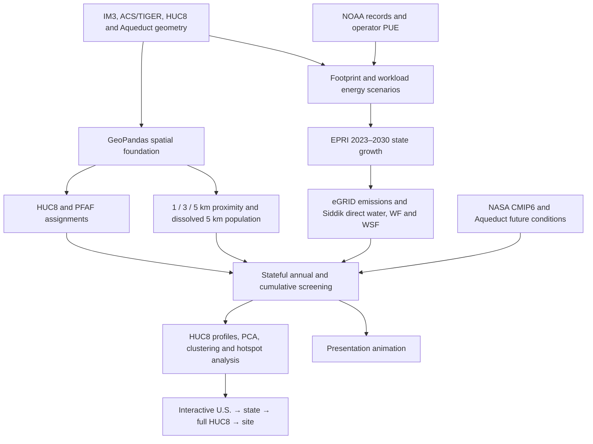

# Spatial foundation: GeoPandas

GeoPandas provides spatial data structures and geometric operations. The project contributes domain-specific modeling, temporal simulation, environmental integration, HUC8 analytics, and interactive screening logic built on those operations.

- **Site points and CRS.** Cleaned IM3 longitude and latitude become an EPSG:4326 GeoDataFrame with `points_from_xy`. The point layer is transformed to the source polygon CRS before the joins. [HUC8 assignment](../src/geo/enrich_huc8.py)
- **Polygon assignments.** Point-in-polygon intersection joins assign HUC8 and Aqueduct PFAF independently. Code tracks missing and ambiguous matches and preserves one output per site. Boundary validation and `make_valid` protect polygon operations. [HUC8 join](../src/geo/enrich_huc8.py) · [Aqueduct join](../src/pipeline/community_resource_pressure.py)
- **Population.** The pipeline constructs 1, 3 and 5 km circles in local azimuthal equidistant CRS and measures tract intersections in EPSG:6933. Each tract contributes population proportional to its covered area. National, HUC8 and PFAF totals dissolve 5 km circles within each group before measuring coverage. Shared area counts once within a group. Different groups may overlap. [Buffers](../src/pipeline/community_resource_pressure.py) · [Dissolved proximity](../src/analysis/stateful_community_simulation.py)
- **Map products.** GeoPackages preserve reusable spatial layers. Local GeoJSON layers and the site-based state/HUC8 crosswalk let the dashboard show complete watersheds across state lines. [Geometry preparation](../src/dashboard/data.py)

# Project implementations built on the spatial foundation

1. **Energy and growth.** Power density, assumed floor area, utilization, idle power and PUE yield modeled facility MWh. A NOAA cooling-degree-day adjustment varies the PUE across sites. State-specific EPRI endpoint ratios determine annual growth from 2023 through 2030.
2. **Annual resource accounting.** The simulation applies fixed eGRID factors for CO₂, CO₂e, NOₓ and SO₂. Direct water uses 1.8 m³/MWh. Siddik WF and WSF remain separate quantities with distinct units.
3. **Environmental integration.** NASA SSP2-4.5 temperature and Aqueduct 4.0 endpoints supply external context. The Aqueduct screening trajectory interpolates compatible stress and depletion ratios. ACS is static proximity context.
4. **State transitions and validation.** Site-year state carries cumulative emissions and direct water. Cardinality, unit, annual-to-cumulative and missing-value checks constrain the model.
5. **Watershed analysis.** HUC8 aggregation retains coverage counts, prepares standardized features for PCA and KMeans, classifies persistent and emerging hotspots, and compares ranks across scenario pairs.
6. **Presentation.** A local Dash application links U.S. → state → full HUC8 → site and updates year, scenario and metrics. The separately generated MP4 and poster provide a static fallback.

See [equations and assumptions](methodology.md), [implementation highlights](implementation_highlights.md) and [results](results.md).
