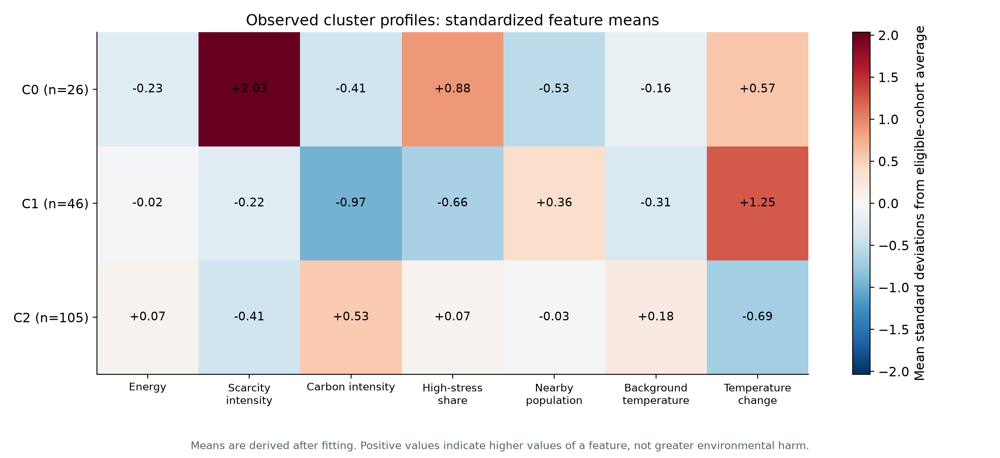
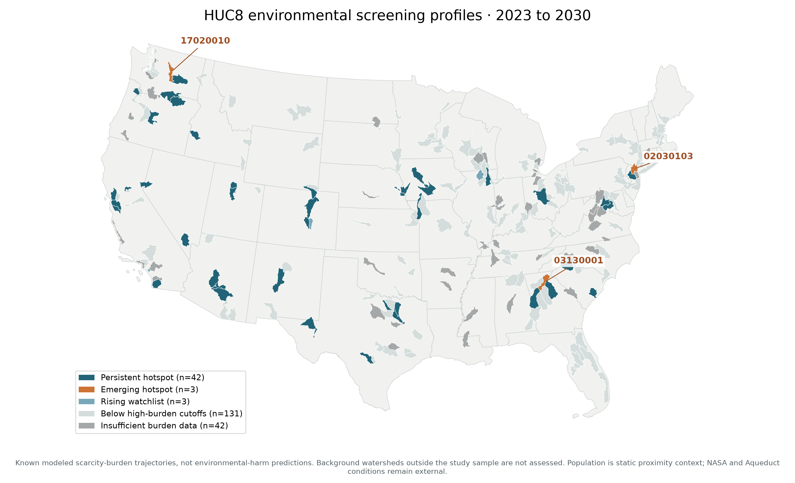

# HUC8 watershed profiles, clustering and robustness

This analysis describes modeled watershed profiles. It does not fit a supervised
environmental-risk target, predict observed harm, infer causal mechanisms from
clusters, or recommend development locations.

Run from the project root in the existing `data-center-impact` environment:

```sh
python3 -m src.analysis.huc8_environmental_profiles
python3 -m pytest tests -q
```

`--tables-only` produces analytical tables without recreating figures. Figures
can be regenerated separately with `python3 -m src.visualization.plot_huc8_profiles`.
The existing simulation equations and `DataCenterSimulation/` are unchanged.

## Geography, aggregation and coverage

HUC8 is the principal unit because it is the native watershed unit of the
Siddik footprint enrichment and supports grouping nearby site records into
watershed profiles. HUC8 is not an Aqueduct Pfafstetter identifier. HUC8 groups
can contain multiple PFAF basins; their site-assigned Aqueduct conditions are
summarized using medians, maxima, known-context coverage and proportions above
the high (raw ratio ≥0.4) and extremely high (≥0.8) thresholds. Unknown conditions
are excluded from the proportion denominator and their coverage is reported.

`huc8_dynamic_profiles_2023_2030.csv` has 5,304 rows: 221 HUC8 groups × eight years
× three paired screening scenarios. It is independently aggregated from the
site-level annual states and checked against the existing HUC8 simulation
summary for counts, energy, emissions, water, environmental medians/maxima and
unique population. Sums use `min_count=1`; wholly unsupported groups stay NaN.
Forty HUC8 groups have no supported electricity estimate. These are not zero-
pressure watersheds.

Population comes from the previously validated dissolved 5-km buffer cache,
`data/processed/stateful_unique_population_5km.csv`. It is not a sum of site
population values. These are people near mapped sites assigned to each HUC8,
not all watershed residents. Buffers are not clipped to watershed boundaries;
group populations overlap and cannot be summed nationally. Population is
static ACS 2019–2023 context, not exposed population or a demographic forecast.
Incomplete-buffer flags remain available and exclude groups from ML and CRPI
when full proximity context cannot be supported.

The actual HUC8 polygons are from the existing Siddik `SI_Shapefile.shp`, key
`HUC_8`. Only geometry and identifiers are used from that legacy shapefile; its
legacy footprint fields do not replace the validated current simulation.
Selected polygons are dissolved by HUC8 and simplified by 500 m for display.
Original geometry and population-processing geometry remain unchanged. Map
coverage is recorded in `huc8_geometry_validation.json`.

## Paired screening scenarios

- `lower_pressure`: EPRI low / Aqueduct optimistic.
- `central`: EPRI moderate / Aqueduct business_as_usual.
- `higher_pressure`: EPRI higher / Aqueduct pessimistic.

All retain NASA SSP2-4.5, one model, and static ACS context. These are paired
screening combinations, not formally coupled socioeconomic/climate pathways.
NASA and Aqueduct remain external conditions, not effects of the modeled
emissions or water demand. Precipitation is absent from the validated NASA
table and is not invented.

## Features, missingness and preprocessing

`huc8_ml_features_2030.csv` retains the requested raw central-2030 burdens,
cumulative accounting, growth, stress, climate, population and site-count
features. Identifiers remain identifiers and never enter the numerical matrix.
Two additional physical ratios help separate magnitude from intensity:

- Scarcity intensity = WSF divided by electricity **for the same records with
  known WSF**, in m³-eq/MWh.
- Carbon intensity = CO2 divided by electricity **for the same records with
  known CO2**, in metric tonnes/MWh.

Ratios are not calculated using a larger denominator cohort than the numerator;
that would make missing coefficients look like low intensity. At least 80% of
the modeled energy must have the relevant coefficients for an intensity to be
used. Known-resource/coverage eligibility, complete population context and
no more than 25% missing shortlist dimensions leave **177 fitted watersheds**;
44 remain unclustered with explicit missing-data status.

The final seven clustering dimensions are electricity demand, matched scarcity
intensity, matched carbon intensity, proportion of known site contexts in high
water stress, unique nearby population, projected background mean temperature,
and projected 2030-minus-2023 temperature difference. The temperature difference
is an endpoint comparison from one model, not a historical anomaly or an
estimated long-term climate trend.

Positive resource variables with skewness >1 are transformed with `log1p`.
Other retained dimensions use their native values. Missing selected features
are filled with the transformed-feature median **only in the eligible ML
matrix**. Raw quantities remain NaN and per-row imputation counts/names are
exported. `StandardScaler` fits this eligible matrix. The preprocessing report
records full-inventory missingness, eligible-cohort missingness, transformations,
imputation medians, selection reasons and before/after statistics. Audit
after-statistics for unselected columns do not imply they entered clustering.

### Redundancy and practical precision

The matrix is deliberately domain balanced rather than a stack of WF, WSF,
energy, direct water and their cumulative versions. Direct demand is an exact
multiple of energy; cumulative burdens are accounting transforms. Site count
is an inventory descriptor, not another independent pressure axis. These remain
in raw profiles but not the clustering shortlist. Candidate correlations are
audited using pairwise-complete Pearson correlations after the documented
transformations and raw Spearman correlations. Shortlist correlations with
absolute value ≥0.97 trigger an explicitly recorded redundancy removal. Moderate
correlation alone does not remove scientifically distinct dimensions.

Central EPRI-derived HUC8 growth ranges from 40.7078% to 40.7116%, a spread below
0.01 **percentage points**. Standardizing that tiny spread would manufacture an
apparent geographic growth signal. Raw growth remains in outputs, but it is
excluded from clustering at the stated precision threshold. Machine-level
rounding is also suppressed at ten significant digits for rank/normalization
operations, without changing source quantities.

Aqueduct raw values at the extreme source cap (9999) are retained for audit but
are not interpreted as precise finite stress changes. Stress correlations use
WRI threshold categories 0–4, and clustering/CRPI use high-stress site share.
Changes involving capped endpoints are flagged/censored in the trajectory
table. No WSF × Aqueduct stress multiplication is performed.

## KMeans and PCA interpretation

KMeans tests k=2 through 8, with random seed 42, 50 initializations and Lloyd's
algorithm. Diagnostics include silhouette, inertia, Calinski–Harabasz and
Davies–Bouldin statistics. A candidate must have at least five watersheds and
at least 5% of the fitted cohort in every cluster. Among size-eligible models,
the smallest k within 0.02 silhouette of the best eligible score is selected.
This size/parsimonious rule is a documented modeling choice, not proof of
discrete natural watershed types.

The final solution has **three broad screening profiles**:

- C0, 26 HUC8s: higher scarcity-weighted intensity / lower nearby population.
- C1, 46 HUC8s: higher projected temperature change / lower electricity carbon intensity.
- C2, 105 HUC8s: higher electricity carbon intensity / lower projected temperature change.

Names are derived after fitting from the largest positive and negative
standardized cluster means. Numeric labels are deterministically ordered by
median energy for display; original algorithmic labels and the mapping remain
available. These profiles are not causal environmental mechanisms or risk classes.

PCA fits the same seven standardized dimensions, not a target or the CRPI.
PC1 explains **25.55%**, PC2 **23.40%** (48.95% together). PC1 has its strongest
positive loading on carbon intensity and negative loadings on endpoint
temperature change, nearby population and electricity. PC2 is positive on
endpoint temperature change and scarcity intensity, and negative on nearby
population, background temperature and electricity. Actual coefficients are
exported and printed; signs are coordinate conventions, not causal directions.
The two-dimensional plot omits about half the variation, so overlap does not
invalidate a full-dimensional fit or establish sharp separation. Cluster
diagnostics and profiles should be reviewed together.



## Persistent and emerging burden trajectories

The hotspot pressure metric is **annual WSF alone**, not an opaque mixture of
correlated burdens. Both endpoints use the same pooled central-2023/2030 WSF
reference. High burden means at least its 75th-percentile value; high change
means at least the 75th percentile of absolute 2023–2030 WSF increase.

Disjoint categories are:

- `persistent_hotspot`: high in both years and high absolute increase.
- `emerging_hotspot`: not high in 2023, high in 2030, and high increase.
- `existing_constrained`: high baseline burden but outside the persistent
  high-and-high-change subtype. This is a modeled burden label, not measured
  local water-supply constraint.
- `rising_watchlist`: newly high in 2030, below the high-change threshold.
- `lower_pressure`: below these high-burden endpoint criteria, **not** a general
  finding of low environmental pressure.
- `not_assessable`: a missing required WSF endpoint; never labeled lower pressure.

There are 42 persistent hotspots, three emerging hotspots and three rising
watchlist groups. No category is forced to contain observations. Separate raw,
percentage and percentile changes in energy, direct water, WF, WSF and stress
are exported. Population change is never included. Fixed Siddik coefficients
mean WF/WSF temporal changes reflect electricity growth, not a coupled future
hydrologic response. The three emerging groups are 17020010, 03130001 and
02030103 under these stated criteria.



## Scenario robustness

WF, WSF and equal-weight CRPI are ranked separately under all three pairings.
Each metric uses a common complete HUC8 cohort across scenarios, avoiding rank
changes caused solely by changing missingness. Rank 1 is the largest metric;
ties use the minimum rank. Exported fields include each scenario rank, range,
top-10-all and top-quartile-all flags. Unknown comparisons stay unranked, not low.

WF and WSF ranks are unchanged across these supplied pairings; this is a finding
of the existing projection structure, not evidence that all real-world future
conditions are irrelevant. CRPI can change as paired conditions and the fixed
normalization curves change. `scenario_robust` in the dashboard specifically
means WSF top quartile under every pairing; it is not an all-purpose robustness
or safety guarantee.

## Community-Resource Pressure Index and weight sensitivity

CRPI is an **analyst-defined 0–100 relative screening index**, not a probability
of harm, observed environmental damage or supervised ML prediction. It does not
enter the clustering matrix or train a target.

The six dimensions are annual WSF burden, proportion of sites with high
Aqueduct stress, annual CO2 burden, energy growth, unique nearby population and
projected warmest-day background temperature. All use fixed central-2030
tied-midrank reference percentiles, with clipping outside the observed range.
All six dimensions must be known with the stated coverage; no index imputation
or weight redistribution is allowed. There are 168 complete central index rows.
Growth is neutral (50) across central HUC8s at the 0.01-percentage-point precision
threshold; lower/higher scenarios below/above that common level receive 0/100.
Raw values remain unchanged. Climate is an explicit context choice rather than
a validated vulnerability dose-response.

In dimension order water / stress / carbon / growth / population / climate:

- Equal: 1/6 each.
- Water-focused: 0.35 / 0.25 / 0.10 / 0.10 / 0.10 / 0.10.
- Community-focused: 0.15 / 0.15 / 0.10 / 0.10 / 0.40 / 0.10.
- Carbon-focused: 0.10 / 0.10 / 0.40 / 0.15 / 0.15 / 0.10.

These are alternative normative choices, not estimated true weights. A single
WSF burden dimension avoids separately weighting WF, WSF and direct demand as
independent quantities. Stress and WSF can still be related; the weight
sensitivity makes that prioritization explicit. No physical water quantities
are added to m³-eq. Twenty-five watersheds remain in the top quartile under all
four weight schemes; the output separately identifies any top-10-all subset.

## Comparatively lower modeled pressure

Seven central-scenario groups are below the 25th percentile for WSF, Aqueduct
raw median stress, CO2 and equal-weight CRPI simultaneously, with adequate known
energy/factor coverage. They are **comparatively lower-pressure watersheds under
modeled criteria**, not safe locations or recommended development sites. This
analysis does not evaluate grid availability, land use, permitting, latency,
water rights, economic feasibility, biodiversity or local infrastructure.

## Reproducibility and outputs

`huc8_analysis_metadata.json` records package versions, input/code hashes,
transforms, scaler parameters, imputation values, chosen features, k diagnostics,
cluster labels, hotspot thresholds, index references, weights and coverage.
All previous tests and focused aggregation/preprocessing/PCA/cluster/hotspot/
robustness/index tests run under the existing environment. The analysis produces
raw and dashboard-ready tables, research figures, two PDF maps, validation and
the final console record. No GitHub push is part of this workflow.
