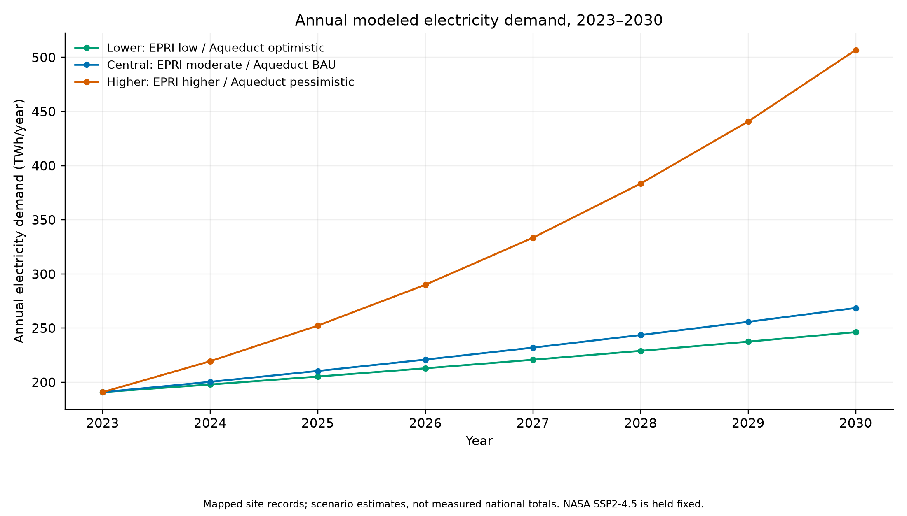
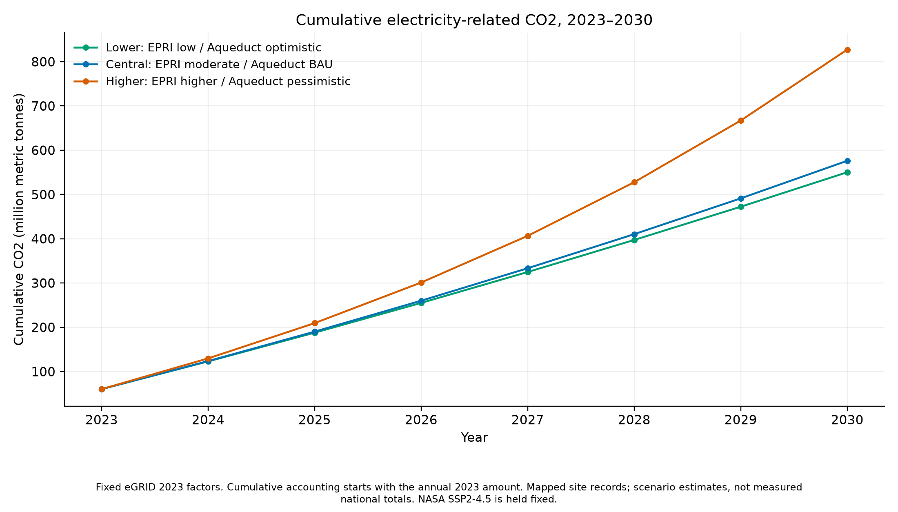
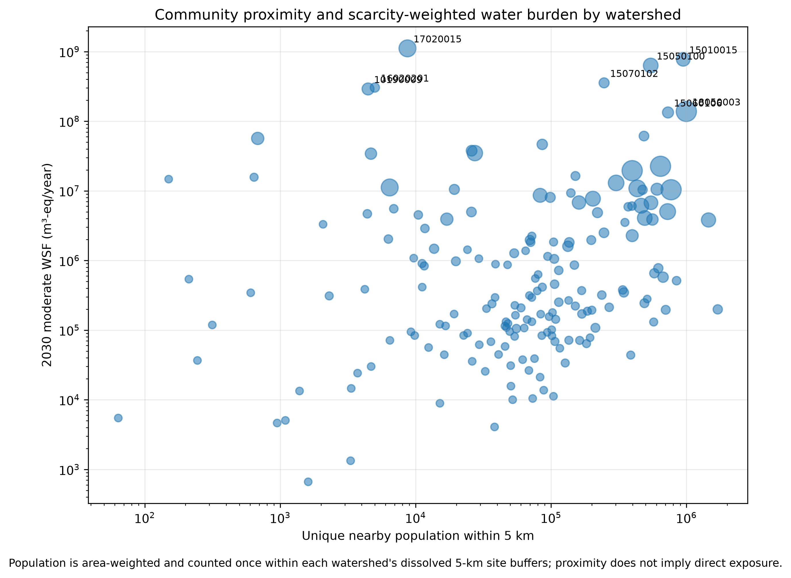
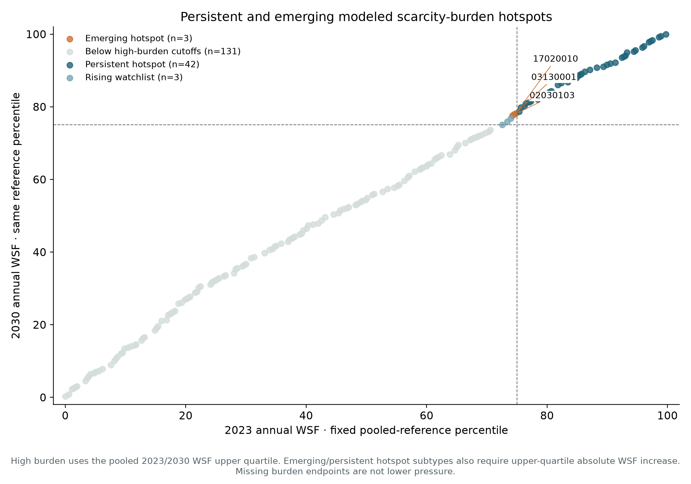

# Results

## Central climate-adjusted screening run

Annual modeled facility electricity increased from **194.6 TWh in 2023 to 273.9 TWh in 2030**, a **40.7%** increase under the selected EPRI trajectory. Electricity-related CO₂ totaled **587.5 million metric tonnes cumulatively** by 2030, with **86.6 million metric tonnes** in 2030 alone. The 2030 coverage was 1,233 site records with projected electricity and 1,210 with CO₂ estimates. [National table](../outputs/final_tables/stateful_community_resource_summary_2023_2030.csv)

For 2030, modeled direct water demand was **493.0 million m³**, total WF **2.49 billion m³**, and WSF **4.65 billion m³-eq**. Water factors supported 1,225 site records. The dissolved national 5 km estimate was **35.8 million nearby people**, with incomplete coverage flagged for three site buffers. Population stays static and estimates proximity only. The median modeled-site study context in the Central summary showed Aqueduct raw stress of **0.203** at the 2023 anchor and **0.273** at the 2030 endpoint. It describes background conditions. [National table](../outputs/final_tables/stateful_community_resource_summary_2023_2030.csv)

## What the metrics mean environmentally

- **Facility electricity (TWh)** measures modeled electricity needed to run IT equipment and facility systems such as cooling. Higher demand can increase the load on the regional grid. Its environmental effects depend on how that electricity is generated.
- **Electricity-related CO₂ (metric tonnes)** estimates the climate-warming emissions associated with that electricity using regional eGRID rates. Annual CO₂ describes one year. Cumulative CO₂ adds the modeled emissions from 2023 through the selected year. The rates represent regional electricity generation, so the totals do not identify emissions at the facility or nearby exposure.
- **Direct water demand (m³)** estimates cooling-related water consumption at facilities using a common coefficient of 1.8 m³/MWh. It represents modeled demand on water resources serving the facility. Actual water sources and cooling designs can vary. Cumulative direct demand adds each year’s estimate and does not measure permanent depletion.
- **Water footprint (WF, m³)** includes direct facility water consumption and indirect consumption associated with electricity generation. Some of this water can be consumed outside the facility’s watershed. Direct demand is already represented in WF, so adding the two would double-count it.
- **Scarcity-weighted water footprint (WSF, m³-eq)** accounts for the relative scarcity of water where it is consumed. The same physical water use can carry more weight in a water-constrained area. WSF is a weighted comparison metric. The **4.65 billion m³-eq** result expresses potential scarcity pressure and does not represent a physical volume withdrawn.
- **Aqueduct water stress (ratio)** describes background demand relative to available renewable water supply. Higher values indicate greater competition for water. The change between the historical anchor and the 2030 endpoint describes external watershed conditions. The simulation does not attribute that change to data centers.
- **Nearby population (people)** counts estimated residents within the combined 5 km buffers using static ACS data. It describes how many people live near mapped sites. Exposure would require evidence about a specific pathway, such as where emissions travel or which water system serves a facility.
- **NASA temperature (°C)** describes projected background climate. It gives context for interpreting resource pressure in warmer conditions. The simulation uses a separate long-term NOAA-based adjustment for facility PUE.

See [methodology and units](methodology.md) and [interpretation limits](limitations.md).

## Watershed profiles

The final analysis covered **221 HUC8 watersheds**, of which **177** were eligible for PCA/KMeans. The three clusters contained **26, 46 and 105** watersheds. Hotspot rules identified **43 persistent** and **two emerging** hotspots. **45** watersheds ranked in the top WSF quartile across all three presentation scenario pairs. [Cluster assignments](../outputs/final_tables/huc8_clusters_2030.csv) · [Hotspot trajectories](../outputs/final_tables/huc8_hotspot_trajectory_2023_2030.csv) · [Rank robustness](../outputs/final_tables/huc8_scenario_rank_robustness.csv)

## Figures from the fixed-PUE analysis

These retained figures illustrate the workflow and earlier fixed-PUE results. The tables above provide the current climate-adjusted figures.

